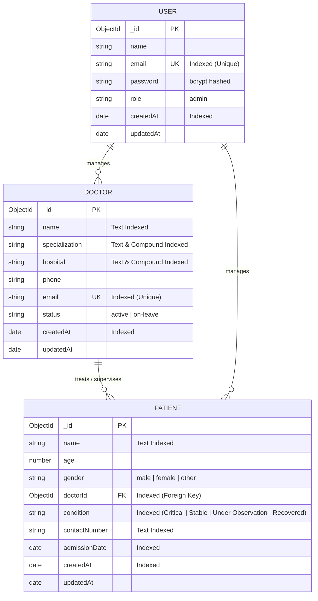

# Database Design Document – Doctor Tracker

## 1. Overview & Data Modeling Strategy
The database for **Doctor Tracker** is designed on **MongoDB** using **Mongoose ODM**. It adopts a hybrid data modeling strategy:
- **Normalized relational references** (`ObjectId` linking Patients to Doctors) to avoid data redundancy and allow independent scalability of patient and doctor records.
- **Embedded indexing strategy** (compound, multi-key, and full-text indexes) to achieve **Index Scan (`IXSCAN`)** on all search, filter, and pagination operations, eliminating expensive collection scans (`COLLSCAN`).
- **Single-stage aggregation pipelines (`$facet`)** for analytics to eliminate N+1 queries and compute dashboard KPIs in a single round-trip.

---

## 2. Entity-Relationship Diagram (ERD)



---

## 3. Detailed Collection Schemas

### 3.1 `users` Collection (Admin Accounts)
Represents authorized administrators permitted to access the administrative portal.

| Field Name | Type | Constraints & Defaults | Description |
| :--- | :--- | :--- | :--- |
| `_id` | `ObjectId` | Auto-generated PK | Unique user identifier |
| `name` | `String` | Required, Trimmed | Full administrative name |
| `email` | `String` | Required, Unique, Lowercase, Trimmed | Login identifier / email |
| `password` | `String` | Required, Select: false | bcrypt-hashed password (cost factor 12) |
| `role` | `String` | Enum: `['admin']`, Default: `'admin'` | Role-based authorization tag |
| `createdAt` | `Date` | Timestamp (Auto) | Record creation timestamp |
| `updatedAt` | `Date` | Timestamp (Auto) | Record update timestamp |

#### Indexes:
1. `{ email: 1 }` – **Unique Index**: Ensures unique login and $O(1)$ lookup for authentication.

---

### 3.2 `doctors` Collection
Represents clinical doctors onboarded to the system.

| Field Name | Type | Constraints & Defaults | Description |
| :--- | :--- | :--- | :--- |
| `_id` | `ObjectId` | Auto-generated PK | Unique doctor identifier |
| `name` | `String` | Required, Min: 3, Max: 100, Trimmed | Full doctor name (e.g. Dr. Sarah Jenkins) |
| `specialization` | `String` | Required, Trimmed | Medical specialty (e.g. Cardiology, Neurology) |
| `hospital` | `String` | Required, Trimmed | Affiliated hospital / clinical center |
| `phone` | `String` | Required, Trimmed | Contact telephone number |
| `email` | `String` | Required, Unique, Lowercase, Trimmed | Official doctor email address |
| `status` | `String` | Enum: `['active', 'on-leave']`, Default: `'active'` | Current employment status |
| `createdAt` | `Date` | Timestamp (Auto) | Onboarding date (used for date-wise filter) |
| `updatedAt` | `Date` | Timestamp (Auto) | Profile last updated |

#### Index Strategy & Rationale:
```typescript
// 1. Text Search across Name, Specialization, and Hospital
DoctorSchema.index(
  { name: 'text', specialization: 'text', hospital: 'text' },
  { weights: { name: 5, specialization: 3, hospital: 2 }, name: 'DoctorTextIndex' }
);

// 2. Compound Index for categorical filtering & sort
DoctorSchema.index(
  { specialization: 1, hospital: 1, createdAt: -1 },
  { name: 'DoctorFilterSortIndex' }
);

// 3. Single Field Index for default reverse chronological ordering
DoctorSchema.index({ createdAt: -1 });

// 4. Unique Index on Email
DoctorSchema.index({ email: 1 }, { unique: true });
```

---

### 3.3 `patients` Collection
Represents patients admitted and assigned under specific physicians.

| Field Name | Type | Constraints & Defaults | Description |
| :--- | :--- | :--- | :--- |
| `_id` | `ObjectId` | Auto-generated PK | Unique patient identifier |
| `name` | `String` | Required, Min: 2, Max: 100, Trimmed | Full patient name |
| `age` | `Number` | Required, Min: 0, Max: 130 | Patient age in years |
| `gender` | `String` | Enum: `['male', 'female', 'other']` | Patient gender |
| `doctorId` | `ObjectId` | Required, Ref: `'Doctor'` | Reference to attending physician |
| `condition` | `String` | Enum: `['Critical', 'Stable', 'Under Observation', 'Recovered']` | Clinical severity level |
| `contactNumber` | `String` | Required, Trimmed | Patient/guardian emergency phone |
| `admissionDate` | `Date` | Required, Default: `Date.now` | Formal intake/admission date |
| `createdAt` | `Date` | Timestamp (Auto) | Record creation date |
| `updatedAt` | `Date` | Timestamp (Auto) | Record modification date |

#### Index Strategy & Rationale:
```typescript
// 1. Foreign Key Compound Index for rapid doctor profile patient roster query
PatientSchema.index(
  { doctorId: 1, createdAt: -1 },
  { name: 'PatientDoctorLookupIndex' }
);

// 2. Compound Index for condition status & admission date filtering
PatientSchema.index(
  { condition: 1, admissionDate: -1 },
  { name: 'PatientConditionDateIndex' }
);

// 3. Text search index on patient name and contact number
PatientSchema.index(
  { name: 'text', contactNumber: 'text' },
  { weights: { name: 4, contactNumber: 2 }, name: 'PatientTextIndex' }
);

// 4. Reverse chronological index for pagination
PatientSchema.index({ createdAt: -1 });
```

---

## 4. Query Optimization & Aggregation Pipelines

### 4.1 Single-Query Dashboard Aggregation Pipeline (`$facet`)
Rather than firing 4 or 5 separate queries over HTTP to compute metrics, a single `$facet` pipeline is executed across the collections:

```javascript
[
  // 1. Doctor-level Facet
  {
    $facet: {
      totalDoctors: [{ $count: "count" }],
      specializationDistribution: [
        { $group: { _id: "$specialization", count: { $sum: 1 } } },
        { $sort: { count: -1 } },
        { $limit: 8 }
      ],
      recentDoctors: [
        { $sort: { createdAt: -1 } },
        { $limit: 5 },
        { $project: { name: 1, specialization: 1, hospital: 1, createdAt: 1 } }
      ]
    }
  }
]
```

### 4.2 Workload Distribution & Patient Aggregation
To calculate **Patients Per Doctor** and **Condition Breakdown**:

```javascript
db.patients.aggregate([
  {
    $facet: {
      totalPatients: [{ $count: "count" }],
      conditionBreakdown: [
        { $group: { _id: "$condition", count: { $sum: 1 } } },
        { $sort: { count: -1 } }
      ],
      patientsPerDoctor: [
        { $group: { _id: "$doctorId", patientCount: { $sum: 1 } } },
        { $sort: { patientCount: -1 } },
        { $limit: 10 },
        {
          $lookup: {
            from: "doctors",
            localField: "_id",
            foreignField: "_id",
            as: "doctor"
          }
        },
        { $unwind: "$doctor" },
        {
          $project: {
            _id: 1,
            patientCount: 1,
            doctorName: "$doctor.name",
            specialization: "$doctor.specialization",
            hospital: "$doctor.hospital"
          }
        }
      ],
      admissionTrends: [
        {
          $group: {
            _id: { $dateToString: { format: "%Y-%m-%d", date: "$admissionDate" } },
            admissions: { $sum: 1 }
          }
        },
        { $sort: { _id: 1 } },
        { $limit: 30 }
      ]
    }
  }
])
```

---

## 5. Performance Execution Profile (`explain('executionStats')`)

| Operation | Query Pattern | Index Used | Scan Type | Time Complexity |
| :--- | :--- | :--- | :--- | :--- |
| **Search Doctor** | Text match `"Sarah"` | `DoctorTextIndex` | `IXSCAN` | $O(\log N)$ |
| **Filter by Date** | `createdAt >= date1 && <= date2` | `DoctorFilterSortIndex` | `IXSCAN` | $O(\log N)$ |
| **List Doctor's Patients** | `find({ doctorId: id }).sort({ createdAt: -1 })` | `PatientDoctorLookupIndex` | `IXSCAN` | $O(K \log N)$ where $K$ = doctor's patients |
| **Filter by Condition** | `find({ condition: "Critical" })` | `PatientConditionDateIndex` | `IXSCAN` | $O(\log N)$ |
| **Paginated Doctor Directory** | `find().skip(offset).limit(limit)` | `{ createdAt: -1 }` | `IXSCAN` | Bounded memory overhead |

---

## 6. Data Integrity & Referential Rules
1. **Cascade Delete Guard:** When a doctor deletion request is received, the system queries the `Patient` collection to verify whether any active patient records reference that `doctorId`. If active records exist, the deletion is rejected with an HTTP 409 Conflict error specifying the count of dependent patients.
2. **Referential Existence Check:** Before assigning or creating a new patient under a doctor, the `doctorId` is checked for active existence in the database.
3. **Data Sanitization:** All incoming text queries are stripped of malicious NoSQL injection syntax (`$where`, `$regex` object injections).
